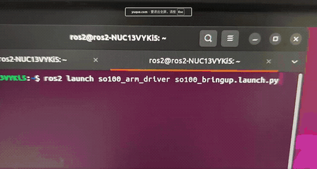
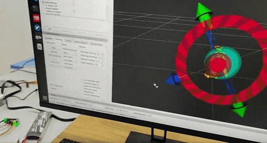

# SO-ARM100 六自由度机械臂 ROS2 工作空间

> 3D 打印机械臂 + STM32 舵机桥接 + ROS2 Humble 驱动 + MoveIt2 运动规划

## 硬件架构

```
Intel NUC (ROS2 Humble)
    │
    ├── USB → CP2102 → STM32F103C8T6 → Yeahbot → LX-16A 舵机 ×6
    │                              ↑
    │                    下位机固件（协议转换）
    │                    0x55 0x55 多舵机帧 → 单舵机帧
```

下位机固件仓库：[stm32_servo_bridge](https://github.com/AURORA520-MAX/stm32_servo_bridge)

## 工作空间结构

```
so100_ws/src/
├── so100_arm_driver/       # ROS2 驱动节点
│   ├── servo_driver.py           # 串口驱动 + FollowJointTrajectory Action
│   ├── repeat_motion.py          # 重复动作演示
│   └── launch/                   # 启动文件
├── so100_description/      # URDF 模型描述
│   ├── urdf/so100.urdf           # SO-ARM100 完整 URDF
│   └── meshes/                   # STL 网格模型
└── so100_moveit_config/    # MoveIt2 运动规划配置
    ├── config/                    # SRDF/kinematics/ompl/joint_limits
    └── launch/                    # move_group 启动文件
```

## 环境要求

| 项目 | 版本 |
|------|------|
| OS | Ubuntu 22.04 |
| ROS2 | Humble |
| MoveIt2 | 2.5.9 (apt) |
| Python | 3.10 |

## 编译

```bash
cd ~/so100_ws
source /opt/ros/humble/setup.bash
colcon build
source install/setup.bash
```

## 启动

```bash
# 基础驱动 + RViz 显示
ros2 launch so100_arm_driver so100_bringup.launch.py

# 完整 MoveIt2 运动规划
ros2 launch so100_moveit_config move_group.launch.py

# 重复动作演示
ros2 run so100_arm_driver repeat_motion
```

## 关节控制

```bash
# 归中
ros2 topic pub /joint_commands std_msgs/Float64MultiArray \
  "{data: [120.0, 120.0, 120.0, 120.0, 60.0, 60.0]}" --once
```

## 功能演示

### 系统登录

系统密码：`ros2`

### 上电基础准备

1. 打开终端，执行设备查询命令：

   ```bash
   ls /dev/ttyUSB*
   ```

   确认输出为 `/dev/ttyUSB0`（若不是，插拔 USB 转 TTL 模块后重新执行，直到确认为 `/dev/ttyUSB0`）。

2. 执行设备权限配置命令：

   ```bash
   sudo chmod 666 /dev/ttyUSB0
   ```

### 功能 1：机械臂重复运动

```bash
# 终端 1
ros2 launch so100_arm_driver so100_bringup.launch.py

# 终端 2
ros2 run so100_arm_driver repeat_motion
```



### 功能 2：运动规划

```bash
ros2 launch so100_moveit_config move_group.launch.py
```



### RVIZ2 鼠标视野操作

| 操作 | 效果 |
|------|------|
| 鼠标左键按住拖动 | 旋转三维视角，全方位查看机械臂模型及运动场景 |
| 鼠标滚轮滚动 | 放大 / 缩小视野，拉近或拉远场景 |
| 鼠标右键按住拖动 | 平移整个视野，调整画面显示位置 |

## 相关文档

| 文档 | 内容 |
|------|------|
| `SO-ARM100_ROS2_完整实施手册.md` | Level 0~3 完整教程 |
| `so-arm100-servo-bridge.md` | 4 种舵机通信方案 |
| `so-arm100-level3-moveit2-success.md` | MoveIt2 部署完整记录 |
| `so-arm100-commands.md` | 命令速查手册 |

## 待实现

- [ ] Level 4：视觉感知（USB 摄像头 + AprilTag/YOLO 物体检测）
- [ ] Level 5：智能抓取（视觉定位 → MoveIt2 规划 → 夹爪执行）
- [ ] 上位机 GUI 控制面板（Web/桌面端）
- [ ] 轨迹录制与回放
- [ ] 多舵机同步速度优化

## 许可证

MIT
